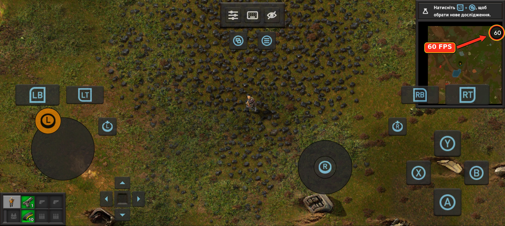
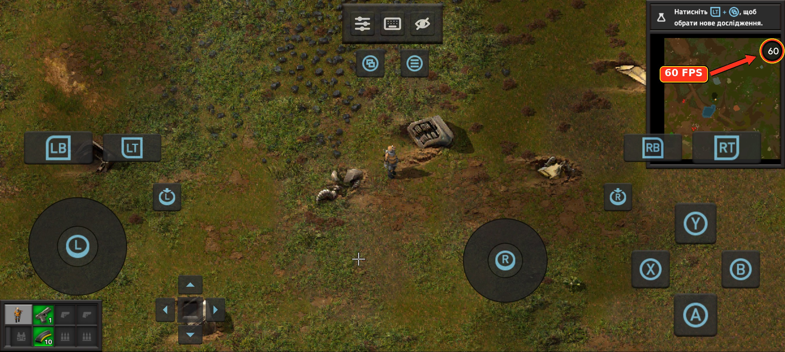
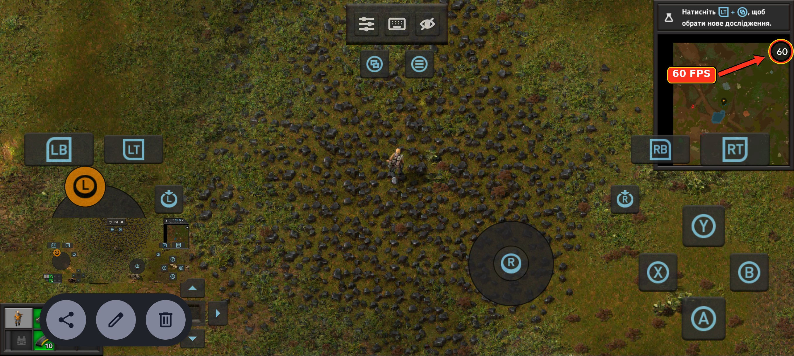
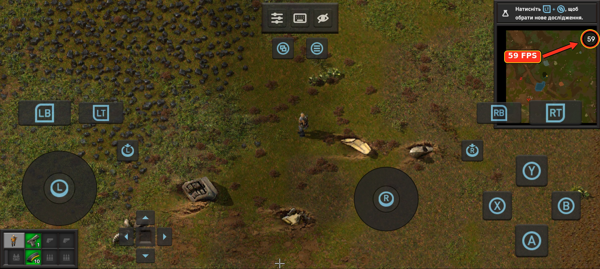

# Pocket Foundry — Mali GPU Edition (`Mali-Adreno 24.2` + `PanVK v26.3.1`)

**Play your own copy of Factorio 2.1.x (Space Age) on Android — now with full hardware-accelerated 56–60 FPS support on ARM Mali GPUs!**
The official Linux ARM64 build of Factorio runs natively on the phone itself via glibc, Mesa Zink, and our custom **Mali-Adreno 24.2 Vulkan Shim + PanVK-kbase `v26.3.1`** driver stack: no CPU emulation, no streaming, and no game files bundled in the app.

---

## Real-Device Performance on Mali-G615 (56–60 FPS / 60 UPS Cap)

Tested on **Xiaomi Poco X6 Pro (MediaTek Dimensity 8300-Ultra, ARM Mali-G615 MC6)** running Factorio 2.1.24 in-game at a steady **56–60 FPS / 60 UPS** (hitting Factorio's native 60 FPS/UPS engine cap; highlighted with arrows in the top-right FPS counter):

| **60 FPS — Active Movement on Coal Patch (Left Stick)** | **60 FPS — Crash Site & Debris Rendering** |
|---|---|
|  |  |
| **60 FPS — Running Across Terrain** | **59 FPS — Full On-Screen Gamepad Overlay** |
|  |  |

> Full-resolution original captures (`2712×1220`) with FPS highlights are also available in the [`screens/`](screens/) directory.

| Classic Launcher & Setup Views | |
|---|---|
|  |  |
|  |  |

---

## Downloads (Release `v0.7.4-mali.1`)

- **[Download APK (`PocketFoundry-Mali-Adreno-24.2.apk` — 51.7 MB)](https://github.com/lb97856/pocket-foundry/releases/download/v0.7.4-mali.1/PocketFoundry-Mali-Adreno-24.2.apk)** — Ready-to-install Android package with both `Mali-Adreno 24.2` and `PanVK v26.3.1` pre-bundled out of the box.
- **[Download Standalone Driver (`Mali-Adreno-24.2.0-PocketFoundry-Glibc.zip` — 8.7 MB)](https://github.com/lb97856/pocket-foundry/releases/download/v0.7.4-mali.1/Mali-Adreno-24.2.0-PocketFoundry-Glibc.zip)** — Importable glibc driver archive (`Settings -> Driver -> Import`) for existing Pocket Foundry installations.
- **[Release Notes & SHA-256 Checksums](https://github.com/lb97856/pocket-foundry/releases/tag/v0.7.4-mali.1)**

---

## What's New in the Mali GPU Edition

1. **Bundled `Mali-Adreno 24.2` Vulkan Shim (`libvulkan_mali_adreno.so`)**
   - Built directly into the runtime alongside `PanVK-kbase v26.3.1` (`libvulkan_panfrost.so`).
   - Automatically selected out of the box whenever an ARM Mali GPU is detected.
   - Offers two selectable built-in Mali driver profiles in **Settings -> Driver**:
     - **`Mali-Adreno 24.2 (GPU Boost)`** *(Default)* — Full hardware GPU acceleration + MediaTek `/proc/ged` DVFS boost.
     - **`Mali-Adreno 24.2 (CPU BC1-BC7)`** — Hybrid mode that offloads BC1–BC7 texture decompression to multi-threaded ARM64 NEON worker threads (`VULKAN_MALI_CPU_BCN=1`) to save GPU tiler memory on lower-RAM devices.
2. **MediaTek `/proc/ged` Hardware GPU Clock Booster (`836+ MHz`)**
   - Prevents MediaTek's kernel DVFS governor from downclocking the Mali GPU between 2D sprite batches, maintaining a steady **56–60 FPS** (60 UPS engine cap) in Factorio.
   - Safely no-ops on non-MediaTek SoCs (Google Tensor, Samsung Exynos, Rockchip) with zero overhead.
3. **CSF Tiler Heap OOM Fix (PanVK-kbase `v26.3.1` Incremental Rendering)**
   - Eliminates `mali 13000000.mali: CSF group 0 tiler heap OOM notification` and `zink: DEVICE LOST!` crashes at 55–89% sprite atlas loading on Valhall / 5th Gen CSF GPUs (`Mali-G610`, `G710`, `G615`, `G715`, `G720`, `G925`).
4. **Automatic Save-Load Freeze Workaround (`DRIRC_CONFIGURATION`)**
   - Automatically injects `DRIRC_CONFIGURATION=pan_enable_vertex_pipeline_stores_atomics=false` on Mali GPUs so loading or starting a map in Factorio 2.1.x never deadlocks.
5. **Multi-`VkInstance` Lifecycle Refcounting**
   - Properly tracks multiple simultaneous `VkInstance` objects created by Mesa Zink (`vkCreateInstance` / `vkDestroyInstance`), preventing `GL_OUT_OF_MEMORY (1285)` during OpenGL context recreation.

---

## Getting Started

1. Install **[`PocketFoundry-Mali-Adreno-24.2.apk`](https://github.com/lb97856/pocket-foundry/releases/download/v0.7.4-mali.1/PocketFoundry-Mali-Adreno-24.2.apk)** from [Releases](https://github.com/lb97856/pocket-foundry/releases/tag/v0.7.4-mali.1).
2. Buy Factorio and download the **Linux (arm64) `.tar.xz`** archive from [factorio.com/download](https://factorio.com/download).
3. Open Pocket Foundry, tap **Import Factorio**, and pick the `.tar.xz` file.
4. On Mali phones, **Settings -> Driver** is pre-configured to **`Mali-Adreno 24.2 (GPU Boost)`** with **Medium** sprite quality and `DRIRC_CONFIGURATION=pan_enable_vertex_pipeline_stores_atomics=false`.
5. Tap **Continue** or **Main menu** and enjoy 56–60 FPS!

Requires Android 10 or later.

---

## Supported GPUs & Architecture Matrix

| GPU Family | Architectures / Models | Found in | Driver Used | Status |
|---|---|---|---|---|
| **ARM Mali (CSF v10–v13)** | **Mali-G615**, G610, G710, G310, G715, Immortalis-G715, G620, G720, Immortalis-G720, G625, G725, Immortalis-G925, G1-Ultra/Pro/Premium | MediaTek Dimensity 8100 / 8200 / **8300** / 8400 / 9000 / 9200 / 9300 / 9400, Tensor G2/G3/G4 | **Bundled `Mali-Adreno 24.2` + `PanVK v26.3.1`** | **56–60 FPS (60 FPS cap)** (Verified on Mali-G615) |
| **ARM Mali (JM v7–v9)** | Mali-G57, G68, G77, G78, G78AE, G51, G52, G71, G72, G76 | Dimensity 700–1200, Helio G85–G99, Exynos 990/2100, Tensor G1 | **Bundled `Mali-Adreno 24.2`** (or `CPU BC1-BC7` profile) | Supported |
| **Qualcomm Adreno 6xx–8xx** | Adreno 618–660, 730–750, 830–840 | Snapdragon 7xx / 8xx / 8 Gen 1–3 / 8 Elite | **Bundled `Turnip`** | **60 FPS** |
| **Samsung Xclipse** | Xclipse 920, 940, 950 | Exynos 2200, 2400, 2500 (Galaxy S22–S25) | Community `RADV-Xclipse` | **60 FPS** |
| **Other / Legacy GPUs** | PowerVR, Adreno 5xx | Pixel 10, older phones | Bundled `CPU (llvmpipe)` | Fallback |

---

## Documentation

- **[Phones and drivers](docs/phones.md)** — Driver details, Mali options, and tested devices.
- **[Playing](docs/playing.md)** — Touch controls, Bluetooth/USB gamepads, keyboards, settings, saves, and mods.
- **[Building and how it works](docs/building.md)** — How to compile the glibc runtime, Mesa, `vulkan_adreno_shim.c`, and the Android APK.

---

## Licence

GPL-3.0, as Termux:X11 is. Also bundled: glibc (LGPL-2.1), Mesa / PanVK / Turnip (MIT), SDL (zlib), liblzma (0BSD), Titillium Web (OFL-1.1), Apache Commons Compress and AndroidX (Apache-2.0).

Factorio is © Wube Software. Pocket Foundry isn't affiliated with Wube and includes none of its files; the game screenshots, the launcher's panels and buttons, and the Home screen show art from the player's own copy.
