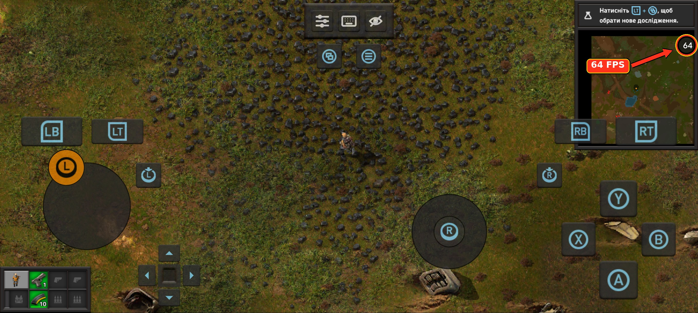

# Phones and drivers

Pocket Foundry draws the game with Mesa's Zink, which runs OpenGL on a Vulkan driver.

- **ARM Mali (Valhall / 5th Gen CSF & Bifrost):** the bundled **`Mali-Adreno 24.2`** Vulkan shim (`libvulkan_mali_adreno.so`) layered over **`PanVK-kbase v26.3.1`** (`libvulkan_panfrost.so`), with MediaTek `/proc/ged` hardware GPU frequency boost.
- **Adreno 6xx and newer:** the bundled driver, **Turnip**.
- **Other GPUs:** a community driver, imported in **Settings -> Driver -> Import**, or the [CPU](#any-other-phone-the-cpu).

**Loads, but slow?** Check **Settings -> Driver**: CPU there means the phone is using software rendering. Select **Mali-Adreno 24.2 (GPU Boost)** on Mali devices or **Turnip** on Snapdragon devices.

---

## Mali (MediaTek Dimensity / Helio, Google Tensor, Exynos)

Works **out of the box** in this build! Pocket Foundry bundles both `libvulkan_mali_adreno.so` (`Mali-Adreno 24.2`) and `PanVK-kbase v26.3.1` (`libvulkan_panfrost.so`) inside the runtime, and automatically sets:
- **Driver:** `Mali-Adreno 24.2 (GPU Boost)`
- **Sprite quality:** `Medium`
- **Driver Options:** `DRIRC_CONFIGURATION=pan_enable_vertex_pipeline_stores_atomics=false` (prevents freezes once a save loads in Factorio 2.1.x)

| Mali Architecture | Models | Bundled Driver Profile | Performance / Notes |
|---|---|---|---|
| **CSF v10–v13 (Valhall Gen 3/4 & 5th Gen)** | **Mali-G615**, G610, G710, G310, G715, Immortalis-G715, G620, G720, Immortalis-G720, G625, G725, Immortalis-G925, G1-Ultra/Pro/Premium | `Mali-Adreno 24.2 (GPU Boost)` | **59–64 FPS, 60 UPS** on Mali-G615 (Poco X6 Pro / realme 16 Pro). Uses CSF Incremental Rendering to prevent tiler heap OOM crashes during sprite loading. |
| **JM v9 (Valhall Gen 1/2)** | Mali-G57, G68, G77, G78, G78AE | `Mali-Adreno 24.2 (GPU Boost)` or `Mali-Adreno 24.2 (CPU BC1-BC7)` | Plays smoothly with Medium sprites. |
| **JM v7 (Bifrost)** | Mali-G51, G52, G71, G72, G76 | `Mali-Adreno 24.2 (CPU BC1-BC7)` | Uses multi-threaded ARM NEON CPU BC1–BC7 texture decompression (`VULKAN_MALI_CPU_BCN=1`). |

---

## Adreno 6xx and newer (Snapdragon)

Works out of the box with the bundled **Turnip** driver. Tested on a vivo X200 Ultra (Adreno 830, Android 16): 60 FPS and 60 UPS on an early-game save.

A newer Turnip can be imported, such as the `turnip_*_arm64.tar.gz` builds from
[lfdevs/mesa-for-android-container](https://github.com/lfdevs/mesa-for-android-container/releases). Freedreno
(OpenGL straight on the GPU) is in the same list. If text looks garbled, try Freedreno.

## Xclipse (Samsung Exynos)

Import `RADV-Xclipse-upstream-Linux.zip` from
[The412Banner/droiddeck-nonadreno-drivers](https://github.com/The412Banner/droiddeck-nonadreno-drivers/releases/tag/radv-xclipse-upstream).
It's a community build of [JimVulkan/radv-xclipse](https://github.com/JimVulkan/radv-xclipse).

## PowerVR and Adreno 5xx

PowerVR (Pixel 10) has no driver that works here yet. Adreno 5xx and older can't run Turnip, and their kernels lack
what freedreno needs. Both can use the [CPU](#any-other-phone-the-cpu).

## Any other phone: the CPU

**CPU** in **Settings -> Driver** draws the game on the phone's processor with Mesa's llvmpipe, no GPU driver
needed. Phones without a GPU driver start with it. It's experimental: slow, and it uses a lot of battery.

---

## Reported working

| Phone | GPU | Driver | Result |
|---|---|---|---|
| **Xiaomi Poco X6 Pro** | **Mali-G615 MC6** | **Bundled `Mali-Adreno 24.2 (GPU Boost)`** | **59–64 FPS, 60 UPS** (MediaTek `/proc/ged` 836+ MHz boost + PanVK v26.3.1) |
| realme 16 Pro | Mali-G615 | Bundled `Mali-Adreno 24.2` / PanVK v26.3.1 | 60 FPS, High/Medium sprites |
| Pixel 6 | Mali-G78 | Bundled / PanVK-kbase | Plays (Medium sprites) |
| Poco M6 Pro 4G | Mali-G57 | Bundled / PanVK-kbase | 25–30 FPS, 60 UPS |
| vivo X200 Ultra | Adreno 830 | Bundled Turnip | 60 FPS |
| OnePlus 15 | Adreno 840 | Bundled Turnip | 60 FPS |
| Galaxy S24 Ultra | Adreno 750 | Bundled Turnip | 60 FPS |
| Xiaomi 13 | Adreno 740 | Bundled Turnip | 60 FPS |
| POCO F5 Pro | Adreno 730 | Bundled Turnip | 60 FPS |
| Galaxy S25 FE | Xclipse 940 | RADV-Xclipse-upstream | 60 FPS |

---

## Importing a custom driver

- Linux (glibc) builds only. Android bionic builds cannot load in the glibc container.
- Accepts `.tar.gz`, `.tar.xz`, `.zip`, or a standalone `.so`.
- Standalone archive for this release: [`Mali-Adreno-24.2.0-PocketFoundry-Glibc.zip`](https://github.com/lb97856/pocket-foundry/releases/download/v0.7.4-mali.1/Mali-Adreno-24.2.0-PocketFoundry-Glibc.zip).
- **Options** passes `NAME=value` settings to the driver (`DRIRC_CONFIGURATION=…`, `PANVK_DEBUG=…`, `TU_DEBUG=…`).

